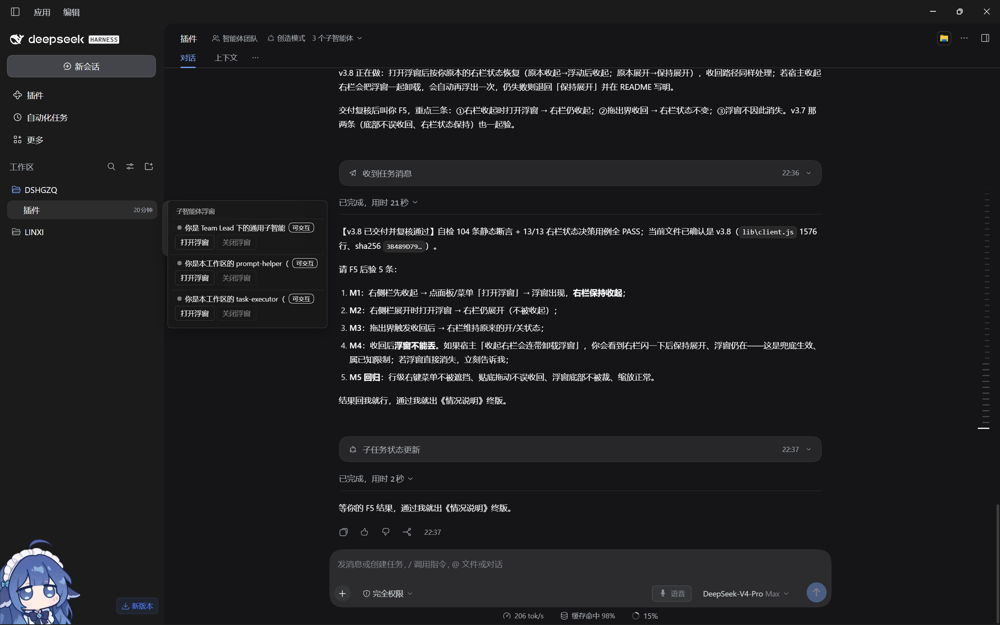
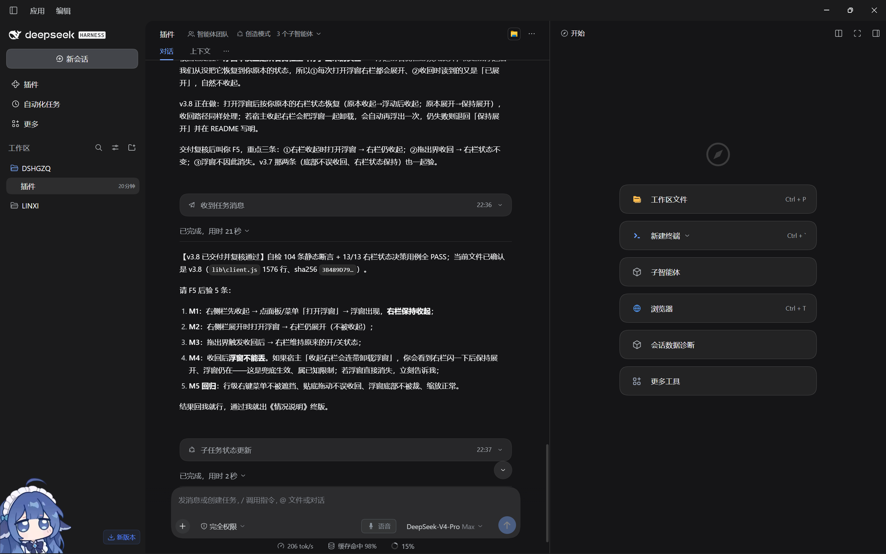
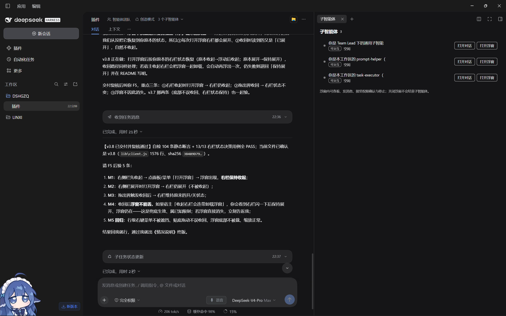
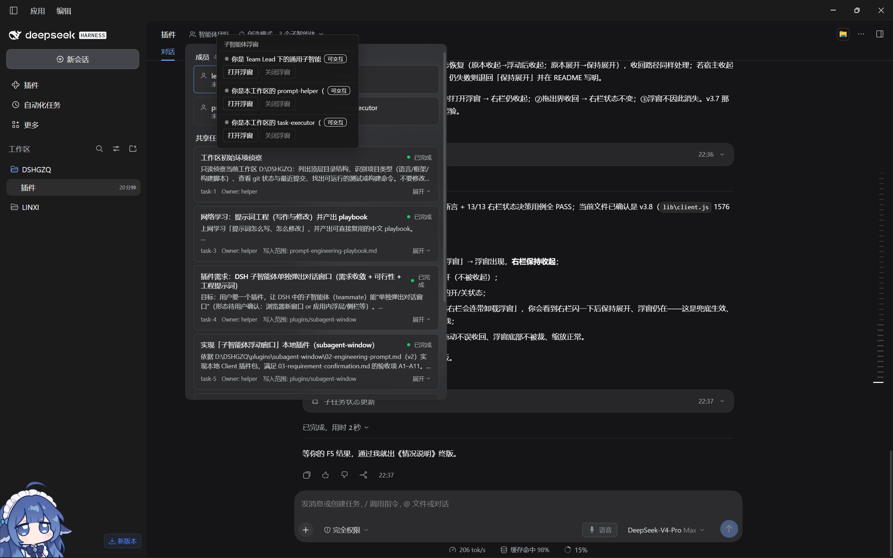
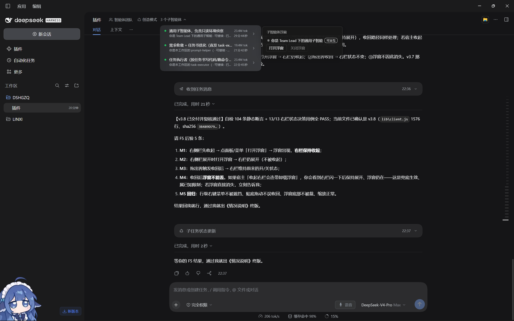
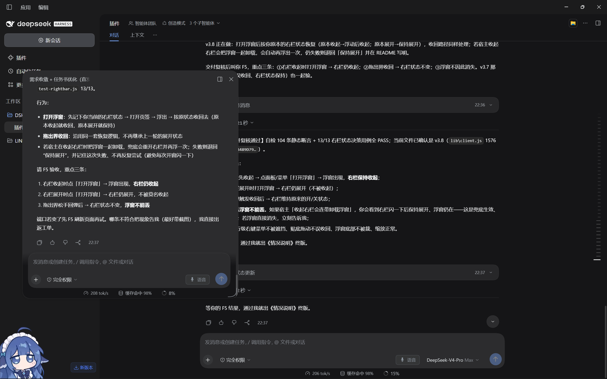

# DSH 子智能体对话浮窗

[](LICENSE)

**把 DSH 子智能体对话从右侧栏「解放」出来，变成应用内可拖动的浮窗。**

Floating, draggable conversation windows for DSH subagents — a client-side plugin for the DSH Web client.

子智能体（subagent）干活时，主会话和子智能体对话往往要来回切换。这个插件把 DSH 内置的 `subagentchat` 对话页签变成**应用内浮窗**：浮窗与页签是同一份对话，可以边看主会话边盯着子智能体，随时查看、发消息、接受权限确认或停止。**关闭浮窗不会结束子智能体**。插件为纯客户端实现，没有服务端组件，也没有第三方依赖。

> 仓库原名 `Sonder-frmc/DSH-` 已更名为 `Sonder-frmc/dsh-subagent-window`；旧地址会被 GitHub 自动跳转（301）到新地址。

<p align="center">
  
  <br>
  <em>子智能体对话浮窗 —— 浮在对话之上，随时查看、发消息、接受权限确认或停止。</em>
</p>

## 功能一览

- **三个入口，随手打开**：右侧栏「开始」页的「子智能体」卡片、主区会话头部右键菜单、右侧栏 `subagentchat` 标签右键菜单；另外内置「N 个子智能体 ⌄」列表的每一行也支持右键。
- **复用内置对话页签**：浮窗里就是内置子智能体对话，查看、发消息、接受权限确认、停止、切换、新建窗口都可用。
- **关闭浮窗 ≠ 结束子智能体**：关掉浮窗只是把窗口收起，子智能体继续运行；再次打开即可回到同一份对话。
- **可拖动、可缩放**：拖动标题栏移动；右下角 28×28 热区缩放；同一页面内记住上次的位置与尺寸（仅内存，不落盘）。
- **不会跑丢**：浮窗位置与尺寸被限制在应用窗口内，拖出界松手后会自动收回；Windows 桌面壳的原生标题栏偏移也已适配，底部输入框不会被裁。
- **不打扰右侧栏**：打开、关闭、拖出界收回浮窗都不会改变右侧栏的展开/收起状态。
- **纯客户端插件**：Host 侧 `apply()` 为空，无服务端组件、无第三方依赖、不修改 DSH 本体文件。

## 界面与使用

### 1. 右侧栏「开始」页卡片

刷新页面后，右侧栏「开始」页会多出一张「子智能体」卡片；点它进入子智能体列表页，每一行都有「打开对话 / 打开浮窗」两个按钮。

<p align="center">
  
  <br>
  <em>「开始」页新增「子智能体」卡片（排在「新建终端」和「浏览器」之间）。</em>
</p>

<p align="center">
  
  <br>
  <em>子智能体列表页：查看每个子智能体的状态，一键「打开浮窗」。</em>
</p>

### 2. 会话头部与列表行右键

在主区会话头部（含「N 个子智能体 ⌄」那行）任意空白处右键，会弹出「打开浮窗 / 关闭浮窗」菜单：主会话下逐行列出全部子智能体，子智能体会话下只针对它自己。内置「N 个子智能体 ⌄」下拉展开时，头部大菜单会自动避让；直接右键下拉里的某一行，则会弹出贴着列表外侧的小菜单。

<p align="center">
  
  <br>
  <em>主会话头部右键：一次看到全部子智能体，逐行打开或关闭浮窗。</em>
</p>

<p align="center">
  
  <br>
  <em>内置子智能体列表行右键：小菜单贴在列表外侧，不被列表遮挡。</em>
</p>

### 3. 右侧栏标签右键

右侧栏里已经打开的 `subagentchat` 标签，右键菜单中会出现「打开浮窗」「关闭浮窗」两项，适合已经在右栏聊着、顺手弹出来的场景。

### 4. 浮窗操作

浮窗拖到应用窗口中间也不会挡死后台：可以拖走、可以缩放、也可以随时关闭再打开。下图是浮窗叠在右侧栏「开始」页上的样子。

<p align="center">
  
  <br>
  <em>浮窗是应用内的独立窗口，叠在任何页面上方，可拖动、可缩放。</em>
</p>

## 安装

### 环境要求

- **DSH Web 客户端**（当前 DSH 客户端版本；桌面壳内亦可，Windows 标题栏偏移已适配）。
- 依赖 DSH 内置的 `subagentchat` 页签与 `@deepseek-ai/dsh-client-ui-conversation` 客户端模块，当前 DSH 客户端均已内置。
- 纯客户端插件：无服务端组件、无第三方依赖，也不需要 npm install。

### 方式 A：从 Release 安装（推荐）

1. 从 [Releases](https://github.com/Sonder-frmc/dsh-subagent-window/releases/tag/v3.10) 下载 [`subagent-window-v3.10.zip`](https://github.com/Sonder-frmc/dsh-subagent-window/releases/download/v3.10/subagent-window-v3.10.zip)。
2. 解压 zip：**根目录直接就是插件目录**，含 `package.json`、`cordis.patch.yml`、`lib/`、`locale/`、`icon.svg`、`README.md`，无需再进一层。
3. 在 DSH 插件管理器里用**该目录的绝对路径**安装。插件管理器接受本地目录的绝对路径（`file:` / `link:` 前缀或裸绝对路径），也接受 `.tgz`；**不支持直接安装 `.zip`**，所以务必先解压。
4. 在插件列表确认 `subagent-window` 为 `enabled=true`、`fiberPhase=active`，然后刷新页面（F5）。

### 方式 B：从源码目录安装

如果你拿到的是插件源码目录（含 `package.json` 与 `cordis.patch.yml` 的那一层），同样在插件管理器里用该目录的绝对路径安装即可，安装后 F5 刷新。

> 不要用 `github:Sonder-frmc/dsh-subagent-window` 简写安装：仓库根目录没有 `package.json`，插件以 zip 形式发布。

## 快速上手

1. 安装并启用插件后，按 F5 刷新页面。
2. 右侧栏「开始」页 → 点「子智能体」卡片 → 在列表页点「打开浮窗」。
3. 或者：在主区会话头部空白处右键 / 右键内置子智能体列表的某一行 / 右键右侧栏 `subagentchat` 标签。
4. 拖动浮窗标题栏移动，右下角热区缩放；点「关闭浮窗」只会关窗，子智能体仍在运行。

## 兼容性

- 仅面向 **DSH Web 客户端**的客户端插件（`dsh.client.platform=web`），Host 侧为空 `apply()`。
- 通过 DSH 客户端模块加载，无需重启 DSH；升级或修改插件后 F5 刷新页面即可生效。
- 插件复用 DSH 内置 `subagentchat` 页签、右侧栏、布局与会话组件；若 DSH 后续版本改动这些内置结构，部分入口可能降级（见「已知局限」）。

## 已知局限

- **不支持四边缩放与最大化**：浮窗只能通过右下角 28×28 热区缩放；dockkit 浮窗没有四边/四角缩放与最大化 API（需求方已确认接受）。
- 拖出应用窗口后松手会「闪一下」收回（先关闭再重开），浮窗内未发送的草稿与滚动位置可能丢失。
- 拖出界期间不做实时约束，只在指针释放时收回；若在浏览器窗口外松手（没有收到释放事件），要等下一次鼠标释放/点击才收回。
- 行级右键依赖内置子智能体列表的 `role="treeitem"`、`aria-label`、React fiber key 与 `aria-haspopup="tree"` 触发器；DSH 升级若改动这些结构，会静默降级为「行级右键无菜单」，其它入口不受影响。
- 浮窗顶部偏移依赖 dockkit 的 `--dsh-dockkit-float-top` / `--dsh-windows-titlebar-height` CSS 变量与 `html[data-windows-titlebar]` 属性；上游若更换实现，底部可能再次被裁，需要重新校准。
- 点击「开始」页卡片默认替换右侧栏当前页签（`replaceTab: true`）。
- 浮窗被外部手动关闭时，列表中「已弹窗」状态最多 1.2 秒后同步。
- 右下角 28×28 缩放手柄与输入框「发送/停止」按钮的右下角有小范围重叠（手柄已从默认 20×20 放大，取舍见版本记录）。
- 尚未在每一个 DSH 版本上逐版本回归；升级 DSH 后建议按上面的清单实测一遍。

## 版本记录

| 版本 | 主要内容 |
|---|---|
| v3.10 | 整洁型瘦身：zh/en 文案合表、统一 best-effort 回退，行数 −7.82%，行为与 UI 零变化 |
| v3.9 | 瘦身：删除死代码、合并重复 JSX/注册样板与重复 CSS 声明，行为与 UI 零变化 |
| v3.8 | 打开 / 收回浮窗不再自动展开右侧栏；右侧栏收起连带卸载浮窗时自动恢复 |
| v3.7 | 修复贴底拖动被误收回；收回后保持右侧栏原来的展开 / 收起状态 |
| v3.6 | 修复拖出界松手不收回：推迟到 dockkit 提交 rect 之后再判定 |
| v3.5 | 右键菜单改用 ReactDOM.createPortal，行级菜单贴列表外侧，不再被内置列表遮挡 |
| v3.4 | 修复 Windows 标题栏偏移导致浮窗底部被裁；拖动 / 缩放越界自动收回；行级右键 label 兜底加固 |
| v3.3 | 子智能体列表行右键小菜单（打开 / 关闭浮窗） |
| v3.2 | 浮窗可用性：28×28 缩放手柄、位置与尺寸钳制、同页面尺寸记忆 |

## 仓库结构

```text
.
├── README.md
├── LICENSE
├── docs/screenshots/            # 6 张功能截图
└── subagent-window-v3.10.zip    # 插件安装包（与 Release 资产相同）
```

## 许可证

本项目采用 [MIT License](LICENSE) 开源，Copyright (c) 2026 Sonder。

## 致谢

- 浮窗、页签与右键菜单复用 DSH Web 客户端内置的 `subagentchat` 页签，以及右侧栏、布局、会话等内置组件。
- 感谢 DSH 团队提供的客户端插件机制与内置子智能体 UI。

## 反馈

遇到问题或有建议，欢迎到 [Issues](https://github.com/Sonder-frmc/dsh-subagent-window/issues) 反馈。
